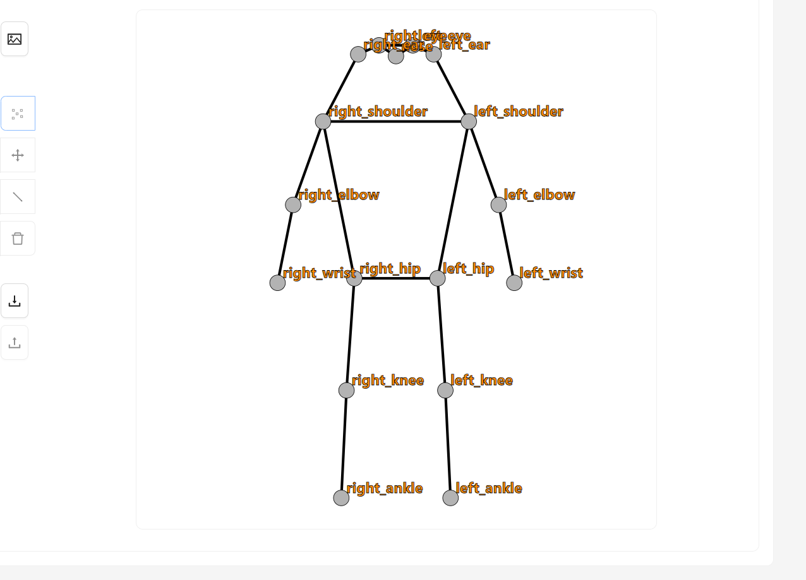
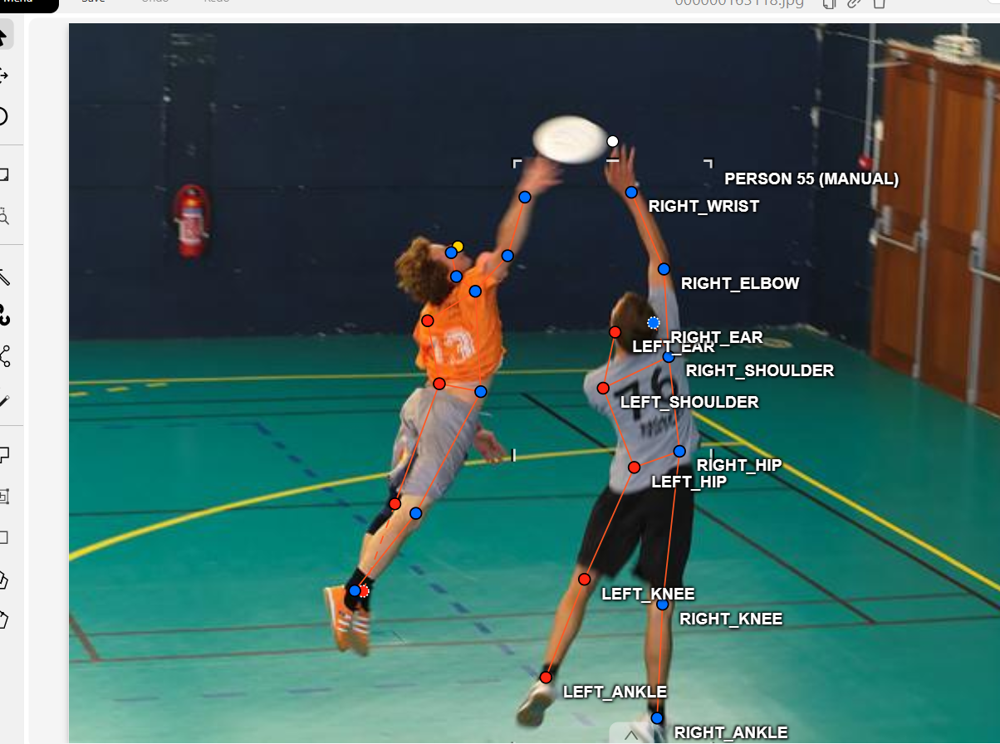
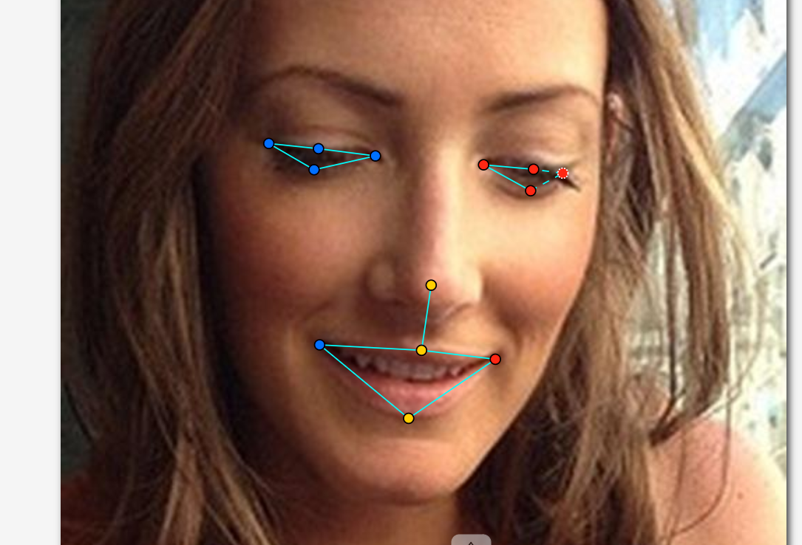
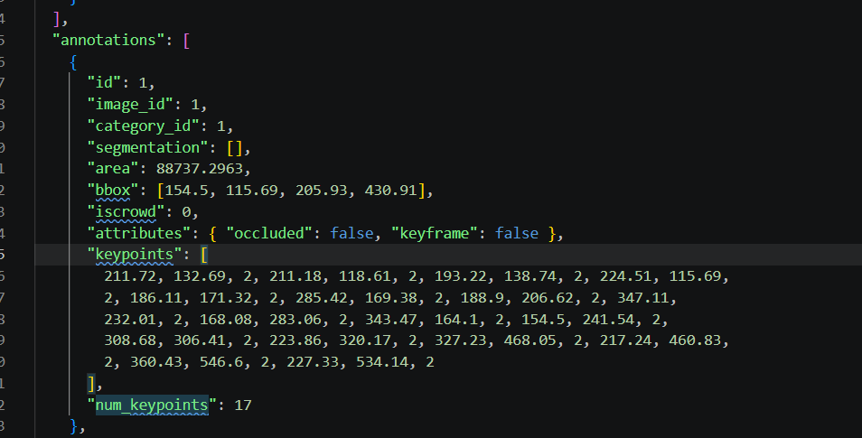

# Báo cáo cá nhân — VuTuyetTrinh-2A202603164

Dữ liệu: 12 ảnh người COCO val2017 (Lin et al., 2014) và 8 ảnh khuôn mặt cắt từ ảnh COCO 2017, chỉ dùng trong lớp.

## 0. Thông tin học viên

- Họ tên: Vũ Tuyết Trinh
- MSSV: 2A202603164
- Email: vutuyettrinh2004@gmail.com
- Link repository: https://github.com/Trintrin0408/K5-L2-DAY04-VuTuyetTrinh-2A202603164-KeypointPose
- Phiên bản CVAT (Help → About): 2.74.1
- Máy: hệ điều hành Windows 11 Pro · RAM 16 GB · chạy CVAT chế độ đầy đủ
- Bộ ảnh (`src/exports/assignment.json` do `lab.py setup` tạo): có
- Giờ bắt đầu: 16h30
- Giờ kết thúc: 19h30

## 1. Kiểm tra label (CP0)


| Label    | Kiểu    | Số điểm | Tên điểm đúng bảng của lab? | Đúng thứ tự? | Số cạnh |
| -------- | -------- | ---------: | ---------------------------------- | ---------------- | --------: |
| `person` | Skeleton |         17 | Có                                | Có              |        19 |
| `face`   | Skeleton |         13 | Có                                | Có              |        13 |

Mẫu `person` dựng theo người quay mặt về camera (các điểm `left_*` nằm bên phải khung mẫu)? Có

Cách đổi cờ `occluded` / `outside` cho **một điểm** trên phiên bản CVAT này (một câu):

Rê chuột vào đúng điểm cần đổi (điểm sáng lên) rồi bấm `Q` để bật/tắt `occluded` (v = 1) hoặc `O` để bật/tắt `outside` (v = 0), hoặc chuột phải vào điểm để chọn trong menu; chỉ điểm đó đổi, các điểm khác của skeleton giữ nguyên. 

## 2. Số lượng đã gán và thời gian (CP1, CP2)


| Nhóm ảnh | Số ảnh | Số skeleton đã gán | Số người dưới 60 px (không gán) | Số poster / gương / màn hình bỏ qua | Thời gian (phút) |
| ---------- | -------: | ---------------------: | -------------------------------------: | ----------------------------------------: | -----------------: |
| `easy`     |        5 |                      5 |                                      0 |                                         0 |         không rõ |
| `occluded` |        3 |                      5 |                                      0 |                                         0 |         không rõ |
| `back`     |        2 |                      4 |                                      0 |                                         0 |         không rõ |
| `small`    |        1 |                      2 |                                      2 |                                         0 |         không rõ |
| `crowd`    |        1 |                      3 |                                      0 |                                         0 |         không rõ |
| `faces`    |        8 |                      8 |                                      0 |                                         0 |                  8 |

* Số ảnh người đã xong ở mốc phút 105: 10 / 10
* Thời gian thực tế (phút): CP1 120 · CP2 40 · CP3 15

- Ảnh tốn thời gian nhất là ảnh nào, vì sao?

Ảnh `crowd` 000000272026: ba người phụ nữ ngồi sát nhau sau bàn, ánh sáng tối. Tay của người bên trái chống cằm nên tôi phải lần từ vai xuống khuỷu rồi cổ tay để không nối nhầm sang người bên cạnh. Hông và chân bị bàn che gần hết nên tôi phải quyết định từng điểm là `v = 1` hay `v = 0`. Ảnh `back` 000000518966 cũng lâu: người đàn ông bên phải bị cắt khỏi khung, chỉ thấy một nửa người.

## 3. Bảng ca khó (CP1, CP2)


| Ảnh         | Người / mặt                               | Điểm                                                   | Cờ đã chọn | Phân vân giữa | Lý do chọn                                                                                                                                                       |
| ------------ | -------------------------------------------- | -------------------------------------------------------- | -------------: | ---------------- | ------------------------------------------------------------------------------------------------------------------------------------------------------------------ |
| 000000122199 | #1 (người phía sau, đeo kính)           | `left_elbow`, `right_elbow`, `left_wrist`, `right_wrist` |              0 | 1 / 0            | Ba lô của người phía trước che gần hết hai tay, không thấy cánh tay trên để suy ra khuỷu, ước lượng sẽ tản mát nên chọn`v = 0`            |
| 000000518966 | #1 (người áo trắng, bị cắt mép phải) | `left_ear`                                               |              1 | 1 / 0            | Người quay lưng, mũ áo che tai nhưng thấy rõ vị trí đầu và vai trái nên ước lượng tai khá chắc                                                |
| 000000518966 | #1                                           | `nose`, `left_eye`, `right_eye`                          |              0 | 1 / 0            | Quay lưng và bị cắt khung, không thấy mặt, không đoán chắc được                                                                                      |
| 000000294379 | #1 (người đi xe đạp)                    | `left_ankle`                                             |              1 | 1 / 0            | Chân trái bị khung xe che. Tôi ước lượng theo đùi và gối trái thấy được, nhưng vị trí bàn đạp bên kia không rõ nên vẫn còn phân vân |
| 000000272026 | #2 (người ở giữa)                        | hông, gối, cổ chân                                   |              0 | 1 / 0            | Bàn và ly che toàn bộ phần dưới, ba người ước lượng sẽ ra ba chỗ khác nhau                                                                         |
| 000000167027 | #4 (người sát mép trái)                 | các điểm bên trái                                   |              0 | 1 / 0            | Người bị mép ảnh cắt, nửa trái nằm ngoài khung →`outside`, không kéo điểm về mép                                                                  |
| face_324513  | mặt kính râm                              | 8 điểm mắt                                            |              1 | 2 / 1            | Kính râm tối che mắt →`occluded`, đặt theo gọng kính                                                                                                      |
| face_469647  | mặt thẳng                                  | `right_eye_outer`, `right_eye_upper`                     |              1 | 2 / 1            | Mắt phải hơi khuất trong bóng tối và tóc, vẫn ước lượng được nên chọn`v = 1`                                                                     |

## 4. Bảng tự review (CP3)

Tôi đi từ ảnh cuối về ảnh đầu, kết hợp đọc các `[CẢNH BÁO]` của `check_submission.py`.


| Ảnh                      | Người / mặt           | Điểm                      | Mã lỗi   | Ghi chú                                                                                                                                          | Đã sửa?              |
| ------------------------- | ------------------------ | --------------------------- | ---------- | ------------------------------------------------------------------------------------------------------------------------------------------------- | ----------------------- |
| 000000272026 (`crowd`)    | #1, #2, #3               | —                          | `ok`       | Ba người quay mặt về camera,`left_*` nằm bên phải ảnh, không có xương vắt sang người khác                                         | —                      |
| 000000167027 (`small`)    | #1, #2 (ngồi dưới ô) | cả skeleton                | `extra`    | Hai người chỉ cao khoảng 22 px và 17 px (< 60 px), không được gán                                                                       | Có, đã xóa skeleton |
| 000000167027 (`small`)    | #4 (sát mép trái)     | —                          | `ok`       | Script cảnh báo cao 56 px vì nửa người bị mép ảnh cắt; tính cả đầu thì người cao trên 60 px nên giữ                           | —                      |
| 000000518966 (`back`)     | #1, #2                   | —                          | `ok`       | Cả hai quay lưng,`left_*` đã nằm bên trái ảnh                                                                                             | —                      |
| 000000163118 (`back`)     | #1, #2                   | —                          | `ok`       | Hai người nhảy bắt đĩa, quay lưng, trái/phải đúng                                                                                      | —                      |
| 000000580257 (`occluded`) | #2 (người bên trái)  | `left_ankle`, `right_ankle` | `ok`       | Script báo cặp ankle ngược phía; kiểm lại thấy người ngồi vắt chéo chân thật (chân phải gác lên chân trái) nên giữ nguyên | —                      |
| 000000294379 (`easy`)     | #1                       | `left_ankle`, `right_ankle` | `ok`       | Script báo ankle ngược phía; người đạp xe, hai bàn chân gần nhau quanh bàn đạp, lệch vài px là hợp lý                          | —                      |
| 000000240340 (`easy`)     | #1                       | `left_ankle`, `right_ankle` | `ok`       | Người ngồi trên xe máy, chân trái vắt chéo trước chân phải nên cổ chân ngược phía là đúng                                   | —                      |
| face_333134 (tóc che)    | mặt                     | `lip_lower`, `nose_tip`     | `position` | `lip_lower` đặt lệch về phía khóe `mouth_right`, không ở giữa môi dưới; `nose_tip` đặt hơi thấp, gần nhân trung                 | Có                     |
| face_105668 (nghiêng)    | mặt                     | `lip_lower`                 | `position` | `lip_lower` đặt gần khóe `mouth_right`, phải dời ra giữa mép ngoài môi dưới                                                           | Có                     |
| face_324513 (kính râm)  | mặt                     | —                          | `ok`       | Tám điểm mắt đều`occluded`, đặt theo gọng; `left_eye_*` bên phải ảnh                                                                  | —                      |

Tổng hợp số lỗi theo mã:


| `lr_swap` | `vis_flag` | `position` | `missing` | `extra` | `ok` |
| --------: | ---------: | ---------: | --------: | ------: | ---: |
|         0 |          0 |          2 |         0 |       1 |    8 |

Điểm còn phân vân giữa `v = 1` và `v = 0` (ghi cả hai lựa chọn và lý do chọn):

- 000000294379 #1 `left_ankle`: chọn `v = 1` vì đùi và gối trái thấy được, cổ chân ở gần bàn đạp. Nếu chọn `v = 0` thì an toàn hơn, vì bàn đạp bên kia có thể đang ở vị trí khác. Tôi giữ `v = 1` vì nghĩ ba người ước lượng sẽ ra gần nhau.
- 000000518966 #1 `left_ear`: chọn `v = 1` vì đầu và vai rõ. Nếu chọn `v = 0` thì do mũ áo che hẳn tai. Tôi giữ `v = 1`.

## 5. Kiểm file xuất và kết quả tự kiểm (CP4)

Tự kiểm tay trong file JSON:


| File                       | Người / mặt kiểm (ảnh, thứ tự) | Số phần tử`keypoints` | Điểm`outside` ra `v = 0`, `occluded` ra `v = 1`?                | `num_keypoints` khớp?                       |
| -------------------------- | ------------------------------------- | -----------------------: | ----------------------------------------------------------------- | -------------------------------------------- |
| `VuTuyetTrinh_persons.zip` | 000000122199, người #1 (phía sau)  |                       51 | Có: 4 điểm tay ra`v = 0`, `left_eye`, `right_eye`… ra `v = 1` | Có: 12 (5 điểm`v = 2` + 7 điểm `v = 1`) |
| `VuTuyetTrinh_persons.zip` | 000000518966, người #1 (quay lưng) |                       51 | Có: mũi, mắt ra`v = 0`, `left_ear` ra `v = 1`                  | Có: 5                                       |
| `VuTuyetTrinh_faces.zip`   | face_324513 (kính râm)              |                       39 | Có: 8 điểm mắt ra`v = 1`                                      | Có: 13                                      |

Sau khi xuất, CVAT ghi `occluded` thành `v = 1` và `outside` thành `v = 0`. Tọa độ của điểm `outside` trong file là `0, 0` hay tọa độ cũ? Tọa độ cũ. Ví dụ `nose` của 000000518966 #1 vẫn là `549.8, 104.74, 0`.

Hai job đã chuyển sang completed trên CVAT? Có

Dán phần **TÓM TẮT** in ra từ `src/check_submission.py`:

```text
- File person: VuTuyetTrinh_persons.zip
  Số ảnh: 12 · số skeleton `person`: 21 · mỗi annotation 51 số
  Skeleton theo ảnh: 000000027565=1, 000000122199=2, 000000163118=2, 000000167027=4, 000000240340=1, 000000261732=1, 000000272026=3, 000000294379=1, 000000399983=1, 000000516902=1, 000000518966=2, 000000580257=2
  Cờ v: v=2 196 (55%) · v=1 67 (19%) · v=0 94 (26%)
  num_keypoints trung bình: 12.5
- File face: VuTuyetTrinh_faces.zip
  Số ảnh: 8 · số skeleton `face`: 8 · mỗi annotation 39 số
  Skeleton theo ảnh: face_105668=1, face_155465=1, face_300399=1, face_324513=1, face_333134=1, face_442231=1, face_469647=1, face_81239=1
  Cờ v: v=2 92 (88%) · v=1 12 (12%) · v=0 0 (0%)
  num_keypoints trung bình: 13.0
- Ghi chú: 94 điểm v = 0 vẫn mang tọa độ cũ (CVAT 2.x xuất như vậy; chuẩn COCO ghi 0, 0). Không phải lỗi: điểm v = 0 bị bỏ qua khi huấn luyện và khi chấm.
- Số [LỖI]: 0 · số [CẢNH BÁO]: 6
Kết quả: ĐẠT (đọc lại từng cảnh báo ở trên)
```

Các `[CẢNH BÁO]` còn giữ nguyên và lý do:

- `000000167027.jpg #4` cao 56 px: người bị mép trái ảnh cắt, tính cả đầu thì cao trên 60 px nên giữ.
- `000000240340.jpg #1` cặp ankle ngược phía: người ngồi trên xe máy vắt chéo chân thật.
- `000000294379.jpg #1` cặp ankle ngược phía: người đạp xe, hai bàn chân sát nhau ở bàn đạp, lệch vài px.
- `000000580257.jpg #2` cặp ankle ngược phía: người ngồi ghế vắt chéo chân thật.
- Hai cảnh báo `000000167027.jpg #1`, `#2` (< 60 px) đã xử lý bằng cách xóa skeleton (lỗi `extra`).

## 6. Ảnh chụp màn hình

1. Label `person` trong label constructor (đủ 17 điểm có tên):

   
2. Một người quay lưng đã gán, cờ đã đặt:

   
3. Một khuôn mặt đã gán 13 điểm, phóng to vùng mắt:

   
4. Một đoạn JSON xuất của một người:

   

Nguồn ảnh: COCO 2017.

## 7. Tự đánh giá

1. Lỗi bạn mắc nhiều nhất hôm nay, và cách bạn sẽ tránh ở dự án thật:

   Lỗi tôi mắc nhiều nhất là `position` ở điểm `lip_lower` của mặt: tôi hay đặt lệch về phía một khóe miệng thay vì giữa mép môi dưới, nhất là với mặt nghiêng và mặt cúi. Ở ảnh `small` tôi còn gán cả người dưới 60 px (`extra`) vì cố gán đủ mọi người. Ở dự án thật tôi sẽ đặt hai khóe miệng trước rồi đặt `lip_upper` / `lip_lower` ở trung điểm giữa hai khóe. Với ảnh nhiều người nhỏ, tôi sẽ đo chiều cao bằng khung bao trước khi vẽ skeleton.
2. Một quy tắc bạn đề xuất thêm vào guideline (kèm ảnh ví dụ nếu có):

   Với miệng nghiêng hoặc đang cười, `lip_upper` và `lip_lower` đặt trên đường vuông góc đi qua trung điểm của đoạn `mouth_left`–`mouth_right`, không đặt theo trục dọc của ảnh. Quy tắc này giúp ba người gán ra cùng một chỗ khi mặt bị nghiêng (ví dụ face_105668).
3. Nhãn của bạn đi vào model ở đâu? Chọn một lỗi bạn đã sửa và nói nó sẽ làm model học sai thế nào (heatmap, trọng số trong loss, hay bước lật ảnh):

   Lấy lỗi `lip_lower` lệch về khóe miệng ở face_105668. Điểm này có `v = 2` nên có trọng số 1 trong loss, và đỉnh heatmap mục tiêu nằm sai chỗ. Model sẽ học rằng "môi dưới" nằm gần khóe miệng. Khi lật ảnh để tăng dữ liệu, `lip_lower` không đổi tên nhưng bị lật sang phía khóe còn lại, nên model nhận hai vị trí mâu thuẫn và heatmap bị nhòe. Hệ quả là khoảng cách `lip_upper`–`lip_lower` (dùng để đo độ mở miệng, ví dụ phát hiện ngáp trong DMS) bị tính sai.

## 8. Khó khăn và lỗi kỹ thuật

- CVAT chạy chế độ đầy đủ trên máy 16 GB RAM, đôi lúc tải ảnh chậm khi chuyển ảnh trong job.
- Với ảnh nhiều người nhỏ hoặc nhiều người chồng lên nhau, rất dễ kéo nhầm điểm của skeleton đã xong. Tôi khắc phục bằng cách khóa (`L`) skeleton đã gán xong.
- Ban đầu tôi chưa quen cách đổi cờ cho một điểm (phải rê chuột đúng điểm rồi mới bấm `Q` / `O`).

## 9. Tài liệu tham khảo và công cụ AI đã dùng

- `docs/GUIDELINE.md`, `docs/CVAT_CHEATSHEET.md`, `docs/COCO_KEYPOINTS.md`, `CHECKPOINTS.md` của repo lab.
- Lin et al., *Microsoft COCO: Common Objects in Context*, 2014.
- Claude (Claude Code): giúp đọc hướng dẫn trong repo. Nhãn trên CVAT do tôi tự gán.
